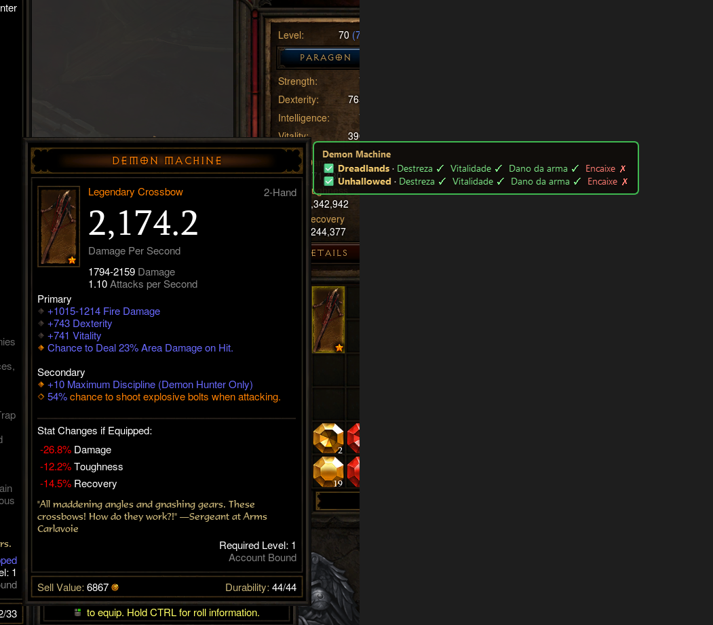

# D3 Companion

App de desktop pessoal pro **Diablo 3**: quando um item cai, você aperta um atalho e o app diz, num selo em cima do jogo, se o item **bate com a sua build** ou não.

O app só **olha a tela** (captura + OCR). Ele não lê a memória do jogo nem se injeta nele, então não viola os termos da Blizzard.



## Como funciona

```
[mouse em cima do item (ou F8)]
        │
        ▼
 1. Captura da tela perto do cursor
        │
        ▼
 2. OCR (Tesseract) ──► texto cru da dica
        │
        ▼
 3. Parser ──► item estruturado (nome, tipo, atributos)
        │
        ▼
 4. Avaliador ──► compara com as builds (arquivos JSON)
        │
        ▼
 5. Overlay ──► ✅ Dreadlands · Destreza ✓ Crítico ✓ Encaixe ✗
```

A lógica (OCR, parser, avaliador) fica num **núcleo** sem interface (`src/nucleo.py`); o overlay só desenha o que o núcleo entrega.

## Roteiro

| Etapa | O que faz | Status |
|---|---|---|
| 1 | OCR de um print salvo | ✅ funcionando |
| 2 | Parser: texto → item estruturado | ✅ funcionando |
| 3 | Formato de build (JSON) + avaliador | ✅ funcionando |
| 4 | Atalho + captura perto do cursor | ✅ funcionando |
| 5 | Overlay em cima do jogo | ✅ funcionando |
| | **Versão 1:** testar tudo dentro do jogo | ✅ testada em 24/10/2026 |
| 6 | Janela principal (pywebview): builds no boneco, histórico, configurações | ✅ primeira versão |
| 7 | Outras classes (só JSON de build novo) + conferência das builds | ✅ funcionando |
| — | Avaliação automática: passar o mouse no item, sem apertar nada | ⏸️ não funcionou no jogo, parada |
| 8a | Dados oficiais da Blizzard: habilidades, itens, ícones (`src/blizzard.py`) | ✅ funcionando |
| 8b | Tela nova: boneco + barra de habilidades com ícones | ✅ funcionando |
| 8c | Importar build do Maxroll: colar o link do guia na janela | ✅ funcionando |
| 8d | Aba Guias: todos os guias do Maxroll, por classe | ✅ funcionando |
| 8e | Upar: o F8 mostra itens parecidos com os da build ("serve por enquanto", selo amarelo) | ✅ funcionando |
| 8f | Marcadores: em que nível libera cada habilidade/runa e onde pôr o paragon | ✅ funcionando |
| 8g | Seu herói (BattleTag) vs. a build | ✅ funcionando |

## O que aprendemos na Etapa 1

- **O OCR lê bem os atributos.** Nome do item, tipo, Destreza, Vitalidade e afixos saíram quase perfeitos.
- **Pré-processar nem sempre ajuda.** Converter pra preto e branco (Otsu) apagou partes de textos finos: `-0.5% Damage` virou `-C.2°. Damage`. Por enquanto, a imagem crua vai melhor.
- **A fonte dos títulos troca "O" por "@"** (`THE CL@AK @F THE GARWULF`). O parser vai ter que corrigir isso.
- **O sinal de menos às vezes some** (`-26.8%` virou `26.8%`). Nos números de "Stat Changes", isso importa.
- **O recorte é essencial.** Quando o print pega a tela de personagem do lado, o OCR mistura tudo. Na Etapa 4, a captura precisa pegar só a dica.

## Etapa 2: o parser

`src/parser.py` transforma o texto do OCR num item em JSON: nome, qualidade, tipo, encaixe, classe, armadura ou DPS/dano, afixos primários e secundários, soquetes e nível. Funciona com itens **lendários, de set e raros**. Itens de set trazem o nome do set e a lista de peças:

```json
"set": { "nome": "Gears of Dreadlands",
         "pecas": [ { "nome": "Antique Vintage Boots", "slot": "Feet" }, ... ] }
```

Gemas lendárias saem com rank e efeitos (o efeito do rank 25 vem marcado com `requer_rank`).

Cada afixo vem com um **modelo** (os números trocados por `#`), que é o que o avaliador da Etapa 3 vai comparar com a build:

```json
{ "texto": "+458 Dexterity", "modelo": "+# Dexterity", "valores": [458] }
```

**Decisões e o que aprendemos:**

- **"Stat Changes if Equipped" é ignorado.** O app compara o item com a build, não com o item equipado. De quebra, some o problema do sinal de menos.
- **O lixo fica nas bordas das linhas.** Marcadores de afixo viram `©`, `@`, `*`, e pedaços do cenário grudam no fim (`+1015-1214 Fire Damage iA`). O parser corta isso.
- **Afixos longos quebram em duas linhas** (`...(Demon Hunter` / `Only)`). O parser junta.
- **Correções de palavras** ficam em `CORRECOES` (`Lite`/`Lie` → `Life`, `Kil` → `Kill`, `ofall` → `of all`...). Quando aparecer um erro novo do OCR, é só adicionar lá.
- **A descrição em itálico não vira afixo.** Quando não há "Stat Changes" separando (item já equipado), o parser descarta as linhas do fim da seção que não têm número nem começam com "+". Só corta do fim, pra não perder um afixo sem número no meio da lista (ex.: "Ignores Durability Loss").
- **Sets: a lista de peças é o ponto de apoio.** O OCR lê muito bem a lista (`Nome (Encaixe)`), e o nome do set é a linha logo acima dela. Os afixos acabam ali, então os bônus `(2) Set:` nunca viram afixo.
- **Nome de item de set vem da lista de peças.** O título usa a fonte decorada e sai embaralhado (`LITANY)@FeTHE/UNDAUNTED`), mas a própria peça está na lista em fonte normal. O parser escolhe a peça mais parecida com o título.
- **Raros e mágicos ficam sem nome** (`null`). O nome é aleatório (`Vampiric Source`), sai embaralhado (`LVAmpiRIseURCE`) e não serve pra avaliar o item.
- **Limitações conhecidas:**
  - Gema **lendária** encaixada conta como encaixe (linha `Nome - Rank N`), e os efeitos dela não viram afixo. Gema **comum** encaixada (ex.: diamante no elmo, "Reduces cooldown...") ainda não: o texto dela é igual ao de um afixo, e só o ícone denuncia.
  - Um afixo sem número que seja o último da lista seria cortado junto com a descrição. Os conhecidos ficam numa lista (`AFIXOS_SEM_NUMERO`, ex.: "Ignores Durability Loss").
  - Erros de número do OCR passam direto: `+13% Life` virou `413% Life` (o "+" lido como "4"), `+157` virou `+187`, `+33%` virou `+39%`. O texto não tem como denunciar isso. **Resolvido na Etapa 4:** com o recorte da dica e o OCR ampliado 2x, os três saem certos.
  - Às vezes a armadura sai `null` (o OCR não leu "Armor" ou separou os dígitos: `5 8 1`). O parser prefere `null` a um número errado.

## Etapa 3: builds e avaliador

As builds ficam em `builds/*.json`, num **formato próprio** do app. Se um dia entrarem builds de sites (Maxroll, Icy Veins), elas serão só *traduzidas* pra esse formato; o avaliador (`src/avaliador.py`) só conhece ele.

```json
{
  "formato": 1,
  "nome": "Gears of Dreadlands — Metralhar",
  "classe": "Demon Hunter",
  "exige_ancient": false,
  "todos_os_espacos": { "obrigatorios": ["+# Dexterity"], "desejaveis": ["+# Vitality"] },
  "espacos": {
    "Head":   { "itens": ["Dystopian Goggles"],
                "desejaveis": ["@soquete", "Critical Hit Chance Increased by #%"] },
    "Finger": { "itens": [],
                "desejaveis": ["@soquete", "Critical Hit Damage Increased by #%"] }
  },
  "gemas": ["Bane of the Trapped", "Zei's Stone of Vengeance"]
}
```

- **`espacos`** usa os nomes do jogo/parser (`Head`, `Hands`, `Finger`...). `Weapon` vale pra `1-Hand` e `2-Hand`.
- **`itens`**: quais itens servem no espaço. Lista vazia = qualquer item, desde que tenha os afixos.
- **`todos_os_espacos`**: afixos que valem pra todo espaço (Destreza sempre primeiro).
- **Afixos** usam o `modelo` do parser. `*` vale por qualquer palavra (`+# * Resistance` aceita Cold, Fire...). `@soquete` olha os soquetes do item. Pra exigir um valor: `{ "modelo": "+# Dexterity", "minimo": 400 }`.
- **`exige_ancient`** pode ser trocado por espaço (no Legacy of Nightmares, os anéis do set não precisam ser Ancient).

**Como o avaliador decide:** o item **bate** quando é permitido no espaço, tem todos os obrigatórios, é Ancient (se exigido) e não é de outra classe. A **nota** é a fração dos desejáveis que ele tem (0 a 1). Quando não bate, o `motivo` diz a primeira regra que falhou.

```
Fiendish Grips — Set Gloves
✅ Unhallowed Essence — Multidisparo: Item da build: Fiendish Grips (nota 0.67)
     tem: +# Vitality, Critical Hit Chance Increased by #%
🟡 Gears of Dreadlands — Metralhar: A build pede: Gas Powered Automail Forearm (nota 0.67)
🟡 Legacy of Nightmares: Precisa ser Ancient (nota 0.67)
```

**O selo explica:** a build de cima mostra o que o item **tem**, o que **falta** e, quando o item tem um afixo que a build não usa, qual trocar no **Místico** (ele troca um afixo por item):

```
Fiendish Grips
✅ Unhallowed · item da build
Tem: Destreza ✓  Vitalidade ✓  Crítico ✓
Falta: Dano crítico ✗
Dica: no Místico, troque "Attack Speed Increased by 5.0%" por Dano crítico.
```

Com "Todas", as outras builds aparecem embaixo numa linha só (ex.: `✅ LoN · 2 de 5 afixos`). A dica não sabe se o item já foi trocado no Místico antes; nesse caso, só dá pra trocar o mesmo afixo de novo.

**Serve por enquanto (pra upar):** quando o item não bate, mas está no espaço certo, tem todos os obrigatórios e **metade ou mais dos desejáveis**, ele *serve por enquanto*: dá pra usar até cair o item da build. O item certo sem ser Ancient também serve por enquanto. O selo fica com a borda **amarela**:

```
Cain's Scrivener
🟡 Por enquanto · Unhallowed · Destreza ✓  Vitalidade ✓  Crítico ✓  Dano crítico ✗
A build pede: Fiendish Grips
```

Sem um obrigatório (ex.: sem Destreza num Caçador de Demônios), ou com menos da metade dos desejáveis, continua **não serve**. No histórico da janela, o filtro "Serve" mostra os dois.

**A revisar nas builds:** só as peças dos sets (vistas nos prints) estão preenchidas; os outros espaços estão com `itens: []`. As **gemas** são um palpite inicial. A prioridade de afixos segue a referência geral do Icy Veins.

## Etapa 4: atalho e captura

`src/app.py` espera o **F8**. Ao apertar, tira um print de uma faixa da tela em volta do mouse, recorta só a dica (`src/captura.py`), lê com OCR e mostra no terminal o veredito de cada build. Cada recorte fica salvo em `capturas/` (fora do Git) pra investigar erros e virar exemplo de teste.

O atalho usa o `RegisterHotKey` do próprio Windows: nada de ler memória ou se injetar no jogo.

**Como a dica é achada:** o miolo da dica é quase **preto puro** (valores 0–4) e as bordas da esquerda e da direita são linhas claras que vão de cima a baixo. O app procura um **par de colunas** com linhas claras longas e da mesma altura, com o miolo majoritariamente preto entre elas, e sem outra borda longa no meio. Se houver duas dicas (a do item e a do equipado), fica com a mais perto do mouse.

**O que aprendemos (medido nos 9 prints, contra um gabarito conferido nas imagens):**

| Como o OCR recebe a imagem | Acertos (afixos + nomes + armadura) |
|---|---|
| Imagem inteira (como era antes) | 49/53 |
| Recorte justo da dica | 40/53 |
| Recorte + folga de 70 px em cima | 44/53 |
| **Recorte + folga + ampliar 2x** | **52/53** |

- **"A maior área preta" não funciona.** O fundo do jogo e as grades do inventário encostam na dica e a área vaza pra tela toda. As bordas verticais são o que separa a dica do resto.
- **O título fica acima das bordas laterais** (nos itens de set), então o recorte precisa de folga em cima.
- **"Linha clara longa" também engana (visto no jogo).** Quando a dica encosta no painel do inventário, a moldura do painel emenda na borda da dica e a "borda" subia até o topo da tela. Agora um pixel só conta como borda se a **maioria dos 10 pixels ao lado (pra dentro) for preta**: ao lado do miolo da dica são 7–10; ao lado da grade do inventário, ~3. No topo, o enfeite do banner do título tapa o miolo, então a borda é esticada pra cima enquanto o vão estreito da moldura dupla continua preto. O print real ficou em `samples/jogo_zei_abaixo_do_inventario.png`, com teste.
- **Ampliar 2x foi o que mais ajudou.** Com isso, todos os afixos e nomes saem certos, inclusive os números que antes saíam errados (`413% Life` → `+13% Life`, `+187` → `+157`). Ampliar 3x piorou.
- **A moldura do título vira letra solta** (`E PAIN ENHANCER`). O parser descarta letra isolada nas pontas do nome.
- A armadura (número grande, fonte serifada) ainda falha às vezes; o parser devolve `null` em vez de um número errado.

## Etapa 5: o overlay

`src/overlay.py` (PySide6) desenha o **selo**: fundo escuro semitransparente, borda verde (serve) ou vermelha (não serve), nome da build em dourado e os afixos com ✓/✗. Ele aparece **à direita da dica** (ou à esquerda, se não couber) e some sozinho depois de `SELO_SEGUNDOS` (padrão 6, ajustável no `.env`).

O selo é uma janela separada do jogo: fica sempre por cima, **deixa o clique passar** e **nunca pega o foco** — senão o jogo em tela cheia poderia minimizar. Antes de cada print, o selo anterior é escondido pra não confundir a detecção da dica.

**Rótulos e apelidos nas builds:** pra caber no selo, cada afixo pode ter um `rotulo` curto e cada build um `apelido`:

```json
"apelido": "Dreadlands",
"obrigatorios": [{ "modelo": "+# Dexterity", "rotulo": "Destreza" }]
```

Sem `rotulo`, o selo mostra o próprio modelo; sem `apelido`, o nome da build. Tudo fica no JSON, nada no código.

**Primeiro teste no jogo (24/10/2026):** gemas e equipamentos com selo certo. Três problemas apareceram e viraram testes com os prints reais (`samples/jogo_*.png`):
- **Dica encostada no inventário** não era achada (veja a Etapa 4).
- **"Hallowed Condemnation" saía "Condemnation"**: o afixo "Ignores **Durability** Loss" era confundido com o rodapé "Durability: 29/29" e a leitura parava antes da lista do set. Agora o fim é `Durability:` com dois-pontos.
- **O selo tampava a dica do item equipado** quando o jogo mostra as duas lado a lado pra comparar. Agora o app acha as dicas coladas na do item e põe o selo do lado de fora do grupo.
- E uma gema lendária encaixada virava afixo do item e não contava como encaixe.

**Como as partes conversam:** o F8 é ouvido numa thread separada, que faz o trabalho pesado (print + OCR, ~1 s) sem travar a interface e manda o resultado pro selo por um *sinal* do Qt. O núcleo (`src/nucleo.py`) monta o texto e a posição do selo sem depender de interface, então tudo isso tem teste sem abrir janela.

## Etapa 6: a janela principal

`python src/janela.py` abre a janela e **liga o overlay junto** (fechar a janela desliga os dois). Três abas:

- **Escolher a build:** clicar numa build faz o atalho avaliar **só com ela** (o selo fala só dela); "Todas" avalia com todas. Vale na hora, sem reiniciar: a escolha vai pro `.env` (`BUILD_ATIVA`) e o overlay relê a cada F8. O histórico mostra com qual build cada item foi avaliado.
- **Builds:** cada build num "boneco" com os 12 espaços. Verde = a build pede um item específico; dourado = qualquer item com os afixos; tracejado = a build não fala do espaço, então valem só as regras gerais (`todos_os_espacos`). Clicando num espaço aparecem os afixos obrigatórios, os desejáveis e as gemas.
- **Histórico:** cada item avaliado no jogo, com a miniatura do recorte e o mesmo selo do overlay. Filtro "Serve / Não serve". Item novo chega sozinho (a janela confere a cada 1,5 s).
- **Configurações:** atalho e tempo do selo, gravados no `.env` (o resto do arquivo fica intacto). Valor inválido não é gravado e a mensagem diz o porquê. As mensagens do overlay (ex.: "F8 ocupado") aparecem aqui também.

**Como as partes conversam.** O overlay (Qt) e a janela (pywebview) querem, os dois, a thread principal — então são **dois processos**. A janela liga o `app.py` como processo filho; o overlay grava cada avaliação em `capturas/historico.jsonl` (uma linha JSON por item) e a janela lê esse arquivo. O JavaScript chama o Python pela ponte do pywebview (`window.pywebview.api`). Nada de rede nem servidor.

**O que aprendemos:**
- **O `python.exe` da `.venv` é só um lançador:** ele abre *outro* `python.exe`, e é esse filho que segura o atalho. Desligar só o processo que a janela abriu deixava o F8 ocupado; por isso o desligamento usa `taskkill /T` (derruba a árvore).
- **Espaço que a build não define não é "não serve".** O avaliador ainda aplica as regras gerais nele (ex.: Destreza). A primeira versão da tela dizia o contrário; a `ficha_da_build` (no avaliador, testada) agora devolve os 12 espaços com `definido: true/false`.
- **Nome de item vem do OCR**, então a página monta tudo com `textContent`, nunca `innerHTML`.
- **Aberta no navegador comum, a página usa dados de exemplo** — dá pra mexer no visual sem jogo nem app.

**Visual (26/10/2026).** Inspirado no d4builds: tela de abertura com barra de progresso; aba Builds como a página de uma build (emblema da classe, sub-abas *Equipamento e habilidades / Paragon / Ao upar*, itens em duas colunas em volta de uma roda com o Cubo de Kanai e as gemas); aba Guias como uma tier list (classes ao lado, busca pelo nome). Os ícones de classe são ícones de habilidades carregados do servidor da Blizzard.

## Etapa 7: outras classes

O código não tem nada fixo de Demon Hunter: o que muda de uma classe pra outra (atributo principal, itens, gemas) está todo no JSON da build. Pra jogar de outra classe:

1. Copie `builds/exemplos/modelo_barbaro.json` para `builds/` com outro nome (ex.: `builds/barbaro_redemoinho.json`). A pasta `exemplos/` não é carregada pelo app.
2. Troque `classe` (`Barbarian`, `Crusader`, `Demon Hunter`, `Monk`, `Necromancer`, `Witch Doctor`, `Wizard`), o atributo principal (`+# Strength`, `+# Intelligence`, `+# Dexterity`) e os itens e gemas, com os nomes em inglês, do jeito que o jogo mostra.
3. Confira:
   ```
   python src/avaliador.py --conferir
   ```

Chave que começa com `_` é comentário (`"_nota": "..."`): o JSON não tem comentário de verdade e o app ignora essas chaves.

**A conferência das builds.** Antes, um JSON errado tinha dois jeitos de dar problema: uma vírgula faltando **derrubava o app inteiro**, e um erro de digitação (`"Hand"` no lugar de `"Hands"`, `"desejavel"` no lugar de `"desejaveis"`) fazia a regra **sumir calada**, e o item passava a "servir" sem você saber por quê. Agora toda build é conferida ao carregar:
- build com problema **fica de fora** e as outras continuam funcionando;
- o problema aparece no terminal do overlay e num aviso vermelho na aba Builds, em português e com sugestão (`Espaço 'Hand' não existe. Quis dizer 'Hands'?`);
- JSON quebrado diz a linha e a coluna.

O que a conferência **não** pega: um `modelo` escrito certo no formato mas que não bate com nenhum afixo do jogo (ex.: `"+# Strenght"`). Pra isso não tem lista oficial de afixos no projeto; o jeito é testar com um print (`python src/avaliador.py <print.png>`).

## Dados oficiais da Blizzard

O app busca na API oficial da Blizzard as habilidades (com runas), os itens e os ícones do jogo, com nome e descrição em português. É a base pra mostrar o boneco e a barra de habilidades de cada build.

**Pegar as chaves (uma vez só):**
1. Entre em https://develop.battle.net com a sua conta Battle.net. Pode pedir o autenticador.
2. **API Access → Create Client**. Nome: `D3 Companion`. Redirect URL: `http://localhost`. Marque que não tem Service URL.
3. Copie o **Client ID** e o **Client Secret** para o `.env`:
   ```
   BLIZZARD_CLIENT_ID=...
   BLIZZARD_CLIENT_SECRET=...
   ```
   Essas chaves são como senha: ficam só no `.env` (fora do Git).

**Testar:**
```
python src/blizzard.py
```
Na primeira vez ele baixa a lista de itens do jogo (~2200 itens, ~20 s) e guarda em `dados/blizzard/` (fora do Git). Depois é instantâneo. Ele também confere se os itens e gemas das suas builds existem no jogo e sugere o nome certo se tiver erro de digitação. Os ícones não são baixados: o app guarda só o endereço da imagem no servidor da Blizzard.

## A tela da build

Na aba **Builds**, cada build aparece:
- **no boneco**: cada espaço com o ícone do item (os dois anéis separados, um de cada lado);
- **embaixo**: o cubo de Kanai e as gemas lendárias;
- **na barra de habilidades**: as 6 ativas (botão esquerdo, botão direito, 1 a 4) com a runa, e as 4 passivas.

Clicar numa habilidade mostra no painel da direita a descrição em português e o que a runa faz. Ícones e textos vêm da Blizzard. Se faltar a chave ou a internet, a tela aparece sem ícones, com um aviso. Build que veio do Maxroll mostra a fonte e um botão pra abrir o guia no navegador.

**Item do cubo conta como "da build":** se o item que você avaliar com o F8 for um dos itens do cubo da build, o selo diz "Vai no cubo de Kanai". Afixos e Ancient não importam nesse caso, porque o que vale é o poder lendário.

### Campos novos no JSON da build (todos opcionais)
```json
"cubo": { "arma": "Odyssey's End", "armadura": "Mantle of Channeling", "joia": "Ring of Royal Grandeur" },
"habilidades": {
  "ativas": [{ "habilidade": "multishot", "runa": "a" }],
  "passivas": ["cull-the-weak"]
},
"fonte": { "site": "maxroll", "planner": 345357607, "perfil": "Sanc: Solo Push Odyssey", "link": "https://maxroll.gg/d3/planner/345357607" }
```
- **Habilidades:** o código da Blizzard em inglês com hífen (`smoke-screen`), até 6 ativas e 4 passivas, na ordem botão esquerdo, botão direito, 1, 2, 3, 4.
- **Runa:** uma letra de `a` a `e`, a mesma que a Blizzard e o Maxroll usam.

## Ao upar e paragon

Embaixo da barra de habilidades da aba Builds:

- **Nível de cada habilidade:** cada botão mostra em que nível ela fica do jeito da build (a habilidade e a runa liberadas). Clicar mostra os dois níveis.
- **Ao upar: quando libera cada coisa** — a lista em ordem de nível, ex.: `Nv 2 Empalamento`, `Nv 28 runa Penetração Superior (Empalamento)`, `Nv 61 Vingança`. Os níveis vêm da API da Blizzard.
- **Paragon:** os pontos da build nos 4 grupos (Principal, Ataque, Defesa, Utilidade), na ordem do jogo, com um resumo: *"Principal: 650 em Vitalidade, 50 em Velocidade, 50 em Recurso máximo, e o resto em Destreza. Nos outros grupos, tudo no máximo (50 cada)."* Vem do perfil do Maxroll (`"paragon"` na build).

## Meu herói (BattleTag)

Na aba **Meu herói**, digite sua BattleTag (ex.: `Arthur#1234`). O app pede à Blizzard os heróis da conta; escolha um e a build pra comparar.

- **Cada item equipado** passa pelo mesmo avaliador do F8: ✅ serve, 🟡 por enquanto, ❌ não serve, com o que tem, o que falta e a dica do Místico.
- **Místico:** a Blizzard diz qual afixo já foi trocado. Se ele já serve, o app não sugere trocar outro, porque só dá pra trocar um por item.
- **Habilidades:** ✓ igual à build, ≈ runa diferente, ✗ falta na sua barra. Também lista o que você usa e a build não usa.
- A BattleTag fica salva no `.env` (`BATTLETAG=`), então não precisa digitar de novo.

Limites da API da Blizzard (não do app): só os itens **equipados** (mochila e baú continuam no F8); os dados **atualizam quando você sai do jogo**, não na hora; só contas da região **Américas** (a do Brasil).

Pelo terminal: `python src/heroi.py Arthur#1234` lista os heróis; `python src/heroi.py Arthur#1234 <id> <build>` compara.

## Builds do Maxroll

**Aba Guias:** escolha a classe do seu boneco e aparecem todos os guias do Maxroll dela (69 no total). **Ver builds** traz as builds do guia pra você escolher e importar; **Ler o guia** abre a página no navegador. Guia que já tem build no app fica com a borda verde.

A lista vem do mapa do site (`maxroll.gg/d3/sitemap.xml`), fica guardada em `dados/maxroll/` e é lida de novo no máximo uma vez por dia. As builds de um guia só são baixadas quando você clica em **Ver builds**: assim o app não puxa o site inteiro de uma vez.

**Pela janela:** na aba Builds, clique em **+ Colar link** e cole o link do guia (ex.: `https://maxroll.gg/d3/guides/shadow-impale-demon-hunter-guide`) ou do planejador. Depois:
1. **Build:** se o guia tiver mais de uma, escolha qual. As da seguidora (Enchantress) ficam de fora.
2. **Perfil:** escolha a variação da build (push, speed, bounties…).
3. **Nome curto:** é o que aparece na janela e no selo. Pode trocar.

A build vai pra `builds/` (nunca sobrescreve outra), **passa a ser a build do atalho** e o overlay reinicia sozinho pra já usar ela.

O Maxroll não tem API oficial. O app lê o mesmo endereço que a página do guia usa pra mostrar a build, **uma build por vez, só quando você pede**. Os itens vêm com o código da Blizzard, e o app acha o nome, o ícone e a descrição.

**Os afixos do guia viram regras.** Pra cada item, o Maxroll diz quais afixos procurar (crítico, encaixe, dano de Empalamento…). O app transforma isso nas regras *desejáveis* daquele espaço, e o selo do F8 mostra, por exemplo:

```
Karlei's Point
✅ Shadow Impale · Destreza ✓  Dano da arma ✓  Dano % ✗  Encaixe ✗  Dano em área ✓
```

Ficam de fora o atributo principal (já obrigatório em tudo), afixos secundários (raio de coleta, espinhos…) e durabilidade. Nos dois anéis, as regras se juntam sem repetir.

```
python src/maxroll.py https://maxroll.gg/d3/guides/shadow-impale-demon-hunter-guide                  # mostra as builds e os perfis
python src/maxroll.py https://maxroll.gg/d3/guides/shadow-impale-demon-hunter-guide --build 1 --perfil 3 --salvar
```
Cada build do Maxroll tem vários **perfis** (push, speed, bounties…); `--perfil` escolhe qual. O link do planejador aparece no guia ao clicar na build e em "Open in Planner".

A build **Unhallowed** já recebeu do guia UE Multishot do Maxroll (perfil *Solo Push Odyssey*):
- as habilidades e o cubo;
- os itens que faltavam: amuleto, cintura, braçadeiras, anéis, arma e mão secundária.

Os itens, regras e gemas que você já tinha ficaram como estavam; a diferença com o guia está anotada no arquivo (`_nota`).

## Avaliação automática (passar o mouse)

> ⚠️ Feita, mas **não funcionou no jogo** no primeiro teste. Está parada; o F8 continua sendo o jeito de avaliar.

Não precisa apertar nada: com o Diablo III na frente, **passe o mouse num item** e o selo aparece sozinho. Ele fica enquanto a dica estiver na tela e some quando ela some. O F8 continua funcionando junto. Liga e desliga em **Configurações → Avaliar sozinho ao passar o mouse** (ou `AUTOMATICO=sim`/`nao` no `.env`).

Como funciona sem pesar no jogo:
- **A olhada barata** (`captura.olhada_rapida`): a cada 0,25 s o app tira um print perto do mouse e reduz 8x, virando um mapa de "quanto preto tem em cada quadradinho". A dica do D3 é um bloco grande quase todo preto, então dá pra achar sem a busca completa. Print + olhada custam ~40 ms; o OCR (~1 s) só roda quando aparece uma dica **nova**.
- **O vigia** (`src/vigia.py`) decide o que fazer com cada olhada, sem saber de tela (por isso tem teste sem jogo):
  - espera a dica **parar de mudar** (duas olhadas iguais) antes de avaliar, pra não ler uma dica pela metade;
  - **voltou num item que já viu**: mostra o resultado guardado, sem OCR;
  - **2 olhadas sem dica**: esconde o selo;
  - o que não era item (dica de habilidade, menu): guarda "não era item" e não tenta de novo.
- **Só olha com o jogo em primeiro plano** (título da janela "Diablo III"): fora dele, um site de tema escuro poderia parecer uma dica.
- **O selo não aparece nos prints** (`SetWindowDisplayAffinity`, Windows 10 2004+): você vê o selo, mas a captura não. Sem isso o vigia veria o próprio selo, acharia que a tela mudou e reavaliaria sem parar. De brinde, o F8 não precisa mais esconder o selo antes do print.
- **Alarme falso não suja o histórico:** no automático, uma "dica" que não deu pra ler não vai pro histórico nem salva print em `capturas/`.
- **Uma trava** impede o F8 e o vigia de rodarem OCR ao mesmo tempo.

## Segurança e privacidade

O app não lida com senha nem dado de pagamento, mas mexe com chave da Blizzard, BattleTag e prints da tela. O que ele faz pra cuidar disso (revisado em 26/10/2026, testes em `tests/test_seguranca.py`):

- **Chaves da Blizzard** só no `.env`, que nunca vai pro Git (o histórico inteiro foi conferido). A janela não consegue ler nem gravar as chaves: só as configurações da lista (`CHAVES` em `src/config.py`), e cada valor é validado — uma quebra de linha não vira outra linha no `.env`.
- **O jogo:** só olha a tela. Nada de ler memória, injetar DLL ou mexer no DirectX.
- **Prints:** ficam só no seu PC (`capturas/`, fora do Git) e o app guarda **só os 200 mais novos**; os mais antigos são apagados sozinhos. O print "sem dica" é a tela inteira, por isso não fica pra sempre.
- **Internet:** só HTTPS, com certificado conferido, e só com o Maxroll e a Blizzard. Cada resposta tem limite de 20 MB (`src/rede.py`).
- **BattleTag:** só letras e números antes do `#`, então não dá pra montar outro endereço na API da Blizzard com ela. O perfil do herói nunca é guardado em disco.
- **Links:** o app só abre no navegador endereços `https://maxroll.gg/...` (sem porta, usuário, espaço ou caractere escondido).
- **Janela:** monta tudo com `textContent` (nunca `innerHTML`) e tem *Content-Security-Policy*: só os arquivos do app e os ícones do servidor da Blizzard. O `'unsafe-eval'` é exigência do pywebview.
- **Dependências** com versão fixa no `requirements.txt` e conferidas na base de falhas conhecidas (OSV). O Pillow foi de 10.4.0 (com dezenas de falhas conhecidas) para 13.0.0.

## Baixar pronto (sem Python)

Site do app: **https://ruthraaz.github.io/d3-companion/** (botão de download direto pra última versão).

Quem só quer usar: baixe o `D3-Companion-<versão>-windows.zip` na página de [Releases](https://github.com/Ruthraaz/d3-companion/releases/latest), descompacte e abra **`D3 Companion.exe`**. O Tesseract já vem junto. Seus dados (builds, prints, `.env`) ficam em `%APPDATA%\D3 Companion`, então trocar de versão não apaga nada. O `LEIA-ME.txt` dentro do zip explica o resto (inclusive o aviso do SmartScreen, porque o .exe não tem assinatura digital).

### Gerar o .exe

```
pip install -r requirements-dev.txt
python ferramentas/empacotar.py
```

Sai em `dist/` (fora do Git): a pasta `D3 Companion/`, o zip e o `.sha256` do zip. O script desenha o ícone, copia do Tesseract instalado **só** o `tesseract.exe`, as DLLs que ele usa de verdade (lidas da tabela de imports: 26 de 51), o inglês e a licença, e roda o PyInstaller (modo pasta, sem console). O mesmo `.exe` faz os dois papéis: sem argumento abre a janela, com `--overlay` é o overlay (`src/d3companion.py`). Onde cada coisa fica, no código e no .exe: `src/pastas.py`. A versão: `src/versao.py`.

## Como rodar (Windows)

O projeto usa **Python 3.12**. Versões mais novas (ex.: 3.15) não têm pacotes prontos para as versões fixadas no `requirements.txt` (Pillow 13.0, NumPy 1.26).

1. Instale o **Python 3.12** e o **Tesseract** (instalador da UB Mannheim):
   ```
   winget install --id Python.Python.3.12 -e
   winget install --id UB-Mannheim.TesseractOCR -e
   ```
2. No terminal, dentro da pasta do projeto:
   ```
   py -3.12 -m venv .venv
   .venv\Scripts\activate
   pip install -r requirements.txt
   ```
3. Se o Tesseract não estiver em `C:\Program Files\Tesseract-OCR\`, copie `.env.example` para `.env` e ajuste o `TESSERACT_CMD` com o caminho certo.
4. Rode:
   ```
   python src/ocr.py samples/lendario_cloak_garwulf.png      # só o OCR (texto cru)
   python src/parser.py samples/lendario_cloak_garwulf.png   # OCR + parser (JSON)
   python src/avaliador.py samples/set_fiendish_grips.png    # recorte + OCR + parser + avaliador
   python src/app.py --testar samples/set_fiendish_grips.png # mostra o selo desse print no meio da tela
   ```
5. **No jogo:** deixe o Diablo 3 em **Tela cheia em janela** (Windowed Fullscreen), dê **dois cliques em `abrir.bat`** (ou rode `python src/janela.py`; funciona mesmo sem ativar a `.venv`) pra abrir janela + overlay ou só `python src/app.py` (só o overlay), passe o mouse num item e aperte **F8**. O selo aparece ao lado da dica (e o resumo no terminal).
   Se outro programa já usar o F8, o app avisa quais teclas estão livres; troque com `ATALHO=` no `.env` (ex.: `ATALHO=Ctrl+F8`).
6. Testes (não precisam do Tesseract, usam os textos salvos em `tests/ocr/` e `tests/ocr_recorte/`):
   ```
   python -m unittest discover tests
   ```
